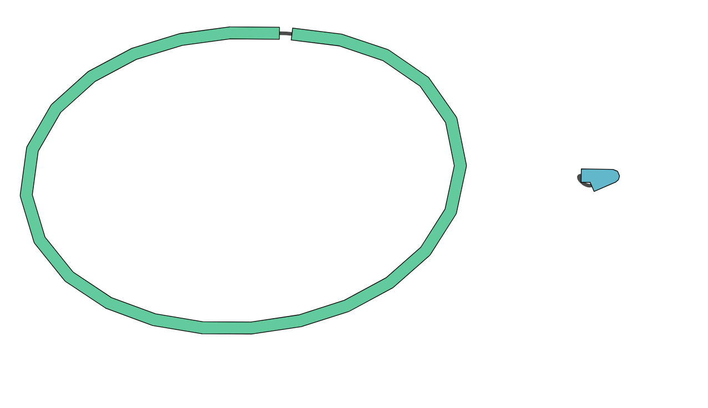

# Long-Read Bacteriomics: Clinical Bacterial Genomics Workflow

## 1. Overview

This report documents a hands-on long-read bacteriomics training workshop delivered through command-line interface (CLI) tools in provided virtual machines (VMs). 
The workshop covered bacterial genome sequencing analysis, from read quality control and preprocessing to species identification, genome assembly, assembly quality 
assessment, and antimicrobial resistance (AMR) profiling.

**Workshop resource:** [Sydney Informatics Hub — Long-Read Sequencing Workshop 2026](https://github.com/Sydney-Informatics-Hub/long-read-sequencing-workshop-2026)
> Geaghan, M., Antczak, M., Herne, C., & O'Brien, M. J. (2026). WORKSHOP: Long read sequencing for bacterial genomics. Zenodo. https://doi.org/10.5281/zenodo.23327650

## 2. Clinical Scenario

Working as a five-person team, *Bug Busters*, we took on the role of newly appointed scientists in the Infection Prevention and Control Team (IPCT) 
at a 1,000-bed teaching hospital.

The hospital's microbiology laboratory referred a bacterial isolate for whole-genome sequencing (WGS) after detecting a carbapenemase-producing 
bacterium in a rectal screening sample from an intensive care unit (ICU) patient. The patient had been admitted three days earlier following emergency abdominal surgery.

Our task was to analyse the sequencing data, identify the most likely bacterial species, characterise its antimicrobial resistance profile, 
and assess whether the isolate presented a potential outbreak risk.

## 3. Executive Summary

**Sample ID:** `ERR8282742`

**Species identification:** *Pseudomonas putida* was the most likely species, based on classification using Kraken with the Kalamari database.

**Genome assembly:** Flye produced two circular contigs: a 6.2 Mb chromosome and a 306 kb smaller contig interpreted as a plasmid. 
Flye's assembly was preferred over the alternative Plassembler assembly for downstream analysis because of the circularity of the contigs and the stronger length match to the plasmid reference database.

**Antimicrobial resistance profile:** AMRFinderPlus identified six unique AMR hits spanning four resistance classes: efflux, beta-lactam (carbapenem), aminoglycoside, and sulfonamide. The associated genes were:

- **Efflux:** `mexE`
- **Beta-lactam:** `blaIMP`
- **Aminoglycoside:** `aac(6')-IB`, `aadB`, and `WP_000259031.1` associated with resistance to kanamycin, gentamicin, and streptomycin
- **Sulfonamide:** `sul1`

The identified AMR genes were not located on a plasmid. The only plasmid-associated match was a stress-related hit in the copper class. 
The AMR genes were full length, except for two additional repeated beta-lactam hits with 50% and 51% identity, which were not included in the six primary AMR hits.

The sample also showed a broader stress-resistance profile than its AMR profile, with six of 20 stress-related hits, 
predominantly associated with mercury and efflux classes.

**Outbreak assessment:** The findings do not suggest a potential outbreak strain. The identified AMR genes were not associated with a plasmid, 
and there was no expression data to assess evidence of these genes being active. These findings informed our assessment of the isolate's potential outbreak risk.

## 4. Analysis Workflow

The workflow covered read quality assessment, preprocessing, species identification, genome assembly, assembly quality assessment, polishing, and AMR profiling.

### 4.1. Read Quality Assessment and Preprocessing

NanoPlot and FastQC were used to assess the sequencing reads, followed by Filtlong for preprocessing with a 1 kbp read-length filter.

The read statistics before and after preprocessing are summarised below.

| Metric | Before preprocessing | After preprocessing |
|---|---:|---:|
| Mean read length (bp) | 7,385 | 16,160.5 |
| Median read length (bp) | 5,440 | 13,948 |
| Mean read quality | 12.7 | 14.2 |
| Number of reads | 39K | 9.3K |
| N50 (bp) | 12,290 | 17,961 |
| Total bases | 306 Mb | 150 Mb |
| Longest read (bp) | 73,346 | 73,346 |
| Quality score of longest read | 12.2 | 12.2 |

Preprocessing increased the mean and median read lengths, improved the mean read quality, and increased the read N50. 
As expected, the number of reads and total bases decreased substantially. The longest read and its quality score remained unchanged.

The reduction in read count and total sequence yield was considered acceptable given the improvements in read-length and quality metrics.

### 4.2. Species Identification

Kraken was used to classify the sequencing reads, with the Kalamari database selected for its relatively modest memory footprint and good coverage of bacterial pathogens.

The classification results were:

- **83.74%:** *Pseudomonas putida*
- **2.47%:** Unclassified
- **Remaining reads:** Distributed among other classified taxa, each representing less than 1% of the reads.

The predominance of *P. putida*, combined with the low proportion of unclassified reads and the small contribution of other individual taxa, 
suggested a relatively clean dataset suitable for downstream genome assembly.

### 4.3. Genome Assembly

Two assemblers, Flye and Plassembler, were used to explore the genome assembly and potential plasmid content.

#### Flye assembly

Flye produced two circular contigs:

| Contig | Length | Coverage | Topology |
|---|---:|---:|---|
| Largest contig | 6.2 Mb | 22× | Circular |
| Smaller contig | 306 kb | 33× | Circular |

The assembly was consistent with a large bacterial chromosome and a smaller plasmid-like sequence.

#### Plassembler assembly

Plassembler detected three contigs. The largest matched the main Flye contig, while the two smaller contigs appeared to represent a split version of Flye's 
second contig. These smaller contigs were non-circular and had limited length matches to sequences in the PLSDB plasmid database.

#### Assembly selection

Flye's assembly was selected for downstream analysis because both contigs were circular, and the smaller contig showed a strong match to a plasmid reference, 
with 99.4% identity across the reported alignment. Its coverage was also slightly higher than that of the main chromosome.

This assembly was therefore preferred for subsequent assembly quality assessment, polishing, and resistance profiling.

### 4.4. Assembly Quality Assessment

Assembly quality was assessed using QUAST and BUSCO, and the assembly graph was visualised using Bandage.

#### QUAST

The initial Flye assembly had the following characteristics:

| Metric | Result |
|---|---:|
| Total assembly length | 6.5 Mb |
| N50 | 6,193.5 kb |
| L50 | 1 |
| L90 | 1 |

The N50 indicates that at least half of the assembled sequence is contained in contigs of this length or longer. 
The L50 of 1 indicates that a single contig accounts for at least 50% of the total assembly length. 
Similarly, an L90 of 1 indicates that the largest contig alone accounts for at least 90% of the assembly.

These results indicate a highly contiguous assembly, with most of the assembled sequence contained in a single contig.

The total assembly length of 6.5 Mb was slightly larger than the approximately 6.2 Mb genome size recorded for *P. putida*. 
This difference could reflect an uncollapsed repeat or another source of additional assembled sequence and was considered during quality assessment.

#### BUSCO

BUSCO (Benchmarking Universal Single-Copy Orthologs) was used to assess genome completeness based on expected conserved genes.

The initial assessment returned:

| BUSCO category | Number |
|---|---:|
| Complete, single-copy BUSCOs | 106 |
| Duplicated BUSCOs | 0 |
| Fragmented BUSCOs | 6 |
| Missing BUSCOs | 4 |

The absence of duplicated BUSCOs and the presence of 106 complete, single-copy BUSCOs, alongside relatively few fragmented and missing BUSCOs, 
raised no serious concerns about assembly completeness. However, polishing was still performed to improve the assembly.

#### Bandage visualisation

Bandage was used to visualise the assembly graph. The graph showed a single large circular contig and a separate smaller circular contig, consistent with the two-contig Flye assembly.

**Assembly graph:**

### 4.5. Assembly Polishing and Reassessment

The selected Flye assembly was polished, after which QUAST and BUSCO were used to reassess assembly quality.

| Metric | Before polishing | After polishing |
|---|---:|---:|
| N50 (kb) | 6,193.5 | 6,195.1 |
| L50 | 1 | 1 |
| Complete BUSCOs | 106 | 113 |
| Duplicated BUSCOs | 0 | 0 |
| Fragmented BUSCOs | 6 | 1 |
| Missing BUSCOs | 4 | 2 |

Polishing resulted in a small increase in N50, while L50 remained unchanged. BUSCO completeness also improved, with seven additional complete BUSCOs, 
fewer fragmented BUSCOs, and fewer missing BUSCOs.

Together, these changes supported the decision to polish the assembly before downstream analysis.

### 4.6. Antimicrobial Resistance Profiling

AMRFinderPlus was used to identify AMR-associated genes, using the most recent database available at the time of analysis in October 2026.

The primary findings comprised six unique AMR hits across four resistance classes.

| Resistance class | Gene(s) identified | Interpretation |
|---|---|---|
| Efflux | `mexE` | Associated with drug efflux |
| Beta-lactam | `blaIMP` | Associated with carbapenem resistance |
| Aminoglycoside | `aac(6')-IB`, `aadB`, `WP_000259031.1` | Associated with resistance to aminoglycosides, including kanamycin, gentamicin, and streptomycin |
| Sulfonamide | `sul1` | Associated with sulfonamide resistance |

Accession records were checked against NCBI to verify the gene annotations.

The identified AMR genes were full length, apart from two additional repeated beta-lactam hits with 50% and 51% identity. 
These additional hits were excluded from the six primary AMR hits.

None of the identified AMR genes was located on a plasmid. The only plasmid-associated match was a stress-related hit belonging to the copper class.

The stress-related profile was broader than the AMR profile, with six of 20 reported stress-related hits, predominantly associated with mercury and efflux classes.

### 4.7. Outbreak Risk Assessment

The final assessment considered species identification, assembly structure, the distribution of AMR genes, and the associated stress-resistance profile.

The analysis identified a likely *Pseudomonas putida* isolate carrying genes associated with resistance to multiple antimicrobial classes. 
However, the identified AMR genes were not plasmid-associated, and there was no evidence that the chromosomally located genes were expressed.

On the basis of these findings, the isolate was not considered suggestive of a potential outbreak strain.

## 5. Conclusion

This exercise provided hands-on experience with a bacterial whole-genome sequencing workflow using command-line bioinformatics tools in a virtual machine environment. 
The analysis covered sequencing quality assessment, read preprocessing, taxonomic classification, genome assembly, assembly quality assessment, polishing, 
and AMR gene identification.
